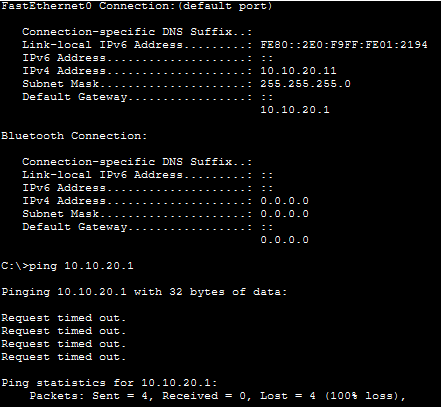
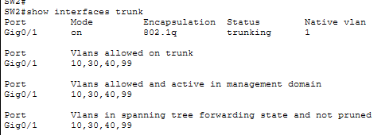
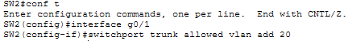
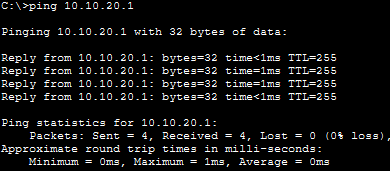

# Incident 1 — Sales VLAN Connectivity Outage

**Severity:** Medium
**Affected Service:** Sales Department Network (VLAN 20)
**Environment:** Enterprise Network Lab

## 1. Incident Summary

The Sales department experienced a network outage that prevented devices in VLAN 20 from reaching their default gateway and resources on other networks. Other departments remained operational, indicating the issue was isolated to Sales.

*Evidence — Initial connectivity failure: gateway ping timed out*

## 2. Troubleshooting Process

I began by testing connectivity between a Sales PC and its default gateway using the `ping` command. The `ping` failed, indicating a connectivity issue between the PC and its gateway. I then accessed the connected switch and ran `show interfaces trunk` to examine the trunk configuration. The output revealed that VLAN 20 (Sales) was missing from the trunk's allowed VLAN list.

## 3. Root Cause

The Sales VLAN (VLAN 20) was missing from the allowed VLAN list on the trunk connecting the access switch to the core switch. Because the trunk was not permitted to carry VLAN 20 traffic, Sales devices could not communicate with their default gateway or other networks.

*Evidence — Switch trunk output: VLAN 20 missing from allowed VLANs*

## 4. Resolution

I accessed the affected switch's trunk interface and used the command `switchport trunk allowed vlan add 20` to restore VLAN 20 to the allowed VLAN list. This allowed Sales traffic to traverse the trunk and reach the rest of the network.

*Evidence — Repair: add VLAN 20 to the trunk allowed list*

## 5. Verification

I tested connectivity from a Sales PC to its default gateway using the `ping` command. The `ping` was successful. I then pinged a device in the IT department to verify that inter-VLAN communication had been restored. Both tests were successful, confirming that the connectivity issue was resolved.

*Evidence — Successful ping to Sales default gateway*

**Final Status: Resolved**
