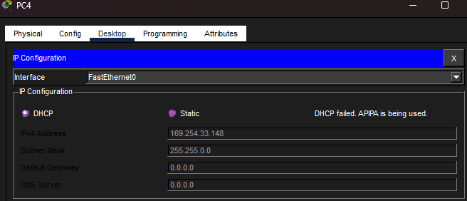
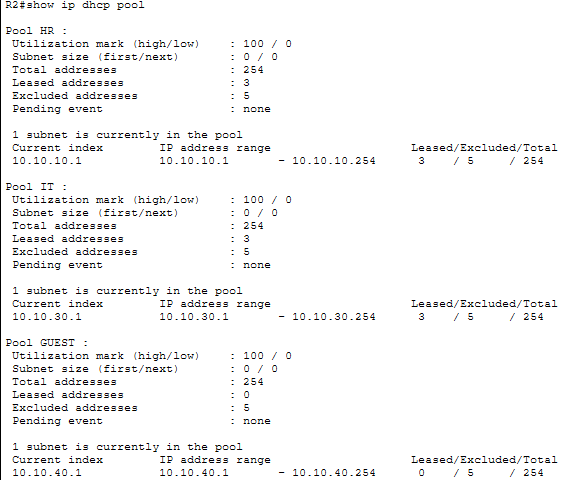
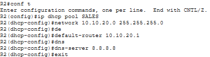
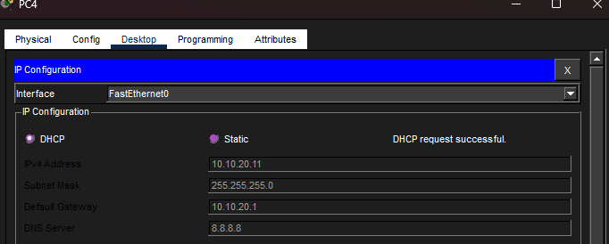

# Incident 2 — DHCP Addressing Failure

**Severity:** Medium
**Affected Service:** DHCP / IP Address Assignment
**Environment:** Enterprise Network Lab

## 1. Incident Summary

A Sales department PC was unable to obtain a valid IP address through DHCP within the VLAN 20 subnet (10.10.20.0/24). This prevented the device from receiving the proper network configuration needed to communicate with other devices.

*Evidence — Sales PC DHCP failure: APIPA address assigned*

## 2. Troubleshooting Process

I began by accessing the affected Sales PC and running `ipconfig` to examine its current IP configuration. The output showed that the PC had been given an APIPA address (169.254.33.148) outside the expected VLAN 20 subnet (10.10.20.0/24). I then accessed the router and ran `show ip dhcp pool` to inspect the configured DHCP pools and determined the SALES DHCP pool was missing, explaining why the PC could not obtain a valid IP address.

*Evidence — R2 DHCP pool inspection during investigation*

*Note: The saved DHCP pool screenshot shows only part of the output; the full pool listing would provide stronger standalone evidence of the missing Sales pool.*

## 3. Root Cause

The Sales DHCP pool for VLAN 20 was missing from the router configuration. Without a pool serving 10.10.20.0/24, the DHCP server could not automatically assign valid addresses to Sales PCs requesting leases.

## 4. Resolution

I resolved the issue by recreating the missing DHCP pool for the Sales department using the `ip dhcp pool SALES` command. I configured the pool with the correct subnet (10.10.20.0/24), default gateway (10.10.20.1), and DNS server (8.8.8.8) to allow Sales devices to receive the appropriate network configuration automatically.

*Evidence — Sales DHCP pool recreated on R2*

## 5. Verification

After recreating the Sales DHCP pool, I ran `ipconfig` on a Sales PC to verify that it had received an IP address within the correct subnet (10.10.20.0/24). The PC displayed the expected IP configuration, confirming that DHCP address assignment was functioning again.

*Evidence — Sales PC receives correct IP, gateway, and DNS from DHCP*

**Final Status: Resolved**
