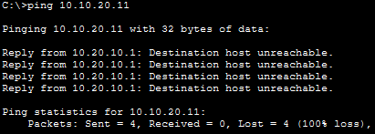
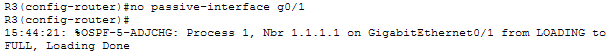
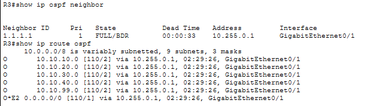
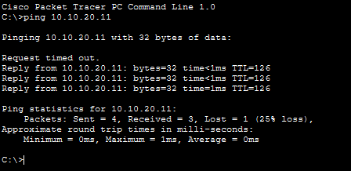

# Incident 3 — OSPF Routing Failure

**Severity:** High
**Affected Service:** HQ-to-Branch Network Connectivity
**Environment:** Enterprise Network Lab

## 1. Incident Summary

Devices in the Branch LAN could not communicate with the HQ network. A `ping` from a Branch PC to a Sales PC at HQ failed, disrupting inter-site access. The lost OSPF-learned routes also affected the Branch router’s route toward the simulated Internet.

*Evidence — Branch-to-HQ ping failed*

## 2. Troubleshooting Process

I began troubleshooting by attempting to `ping` a Sales PC at HQ (10.10.20.11) from a Branch PC. The test returned "Destination host unreachable" from the Branch default gateway (10.20.10.1), suggesting a routing issue. I then accessed the Branch router (R3) and ran `show ip ospf neighbor` to check its OSPF neighbor relationships. The output was empty, indicating that no OSPF neighbors were established. Next, I ran `show ip route ospf` to check for dynamically learned routes. This command also returned no entries, confirming that R3 had no OSPF-learned routes to the HQ networks.

*Evidence — R3 showed no OSPF neighbors or learned routes*

## 3. Root Cause

The Branch router's GigabitEthernet0/1 interface was configured as passive under OSPF. This prevented OSPF Hello packets from being exchanged with the HQ router, causing the OSPF neighbor relationship to fail. As a result, the Branch router lost its OSPF-learned routes to the HQ networks.

## 4. Resolution

I accessed the Branch router (R3) and entered the OSPF routing configuration using `router ospf 1`. I then issued `no passive-interface g0/1` to allow OSPF Hello packets to be exchanged with the HQ router. The OSPF neighbor relationship subsequently returned to the FULL state.

*Evidence — Removed OSPF passive setting from R3 G0/1*

## 5. Verification

After resolving the issue, I ran `show ip ospf neighbor` and confirmed the neighbor relationship reached FULL state. I then ran `show ip route ospf` and verified that the Branch router had learned the HQ routes through OSPF. I also repeated the `ping` from a Branch PC to the HQ Sales PC (10.10.20.11); three of four attempts succeeded, confirming that inter-site connectivity had been restored.

*Evidence — OSPF neighbor FULL and learned routes restored*

*Evidence — Post-fix Branch-to-HQ ping succeeded (3/4 replies)*

**Final Status: Resolved**
