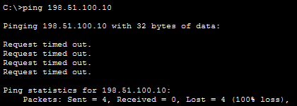
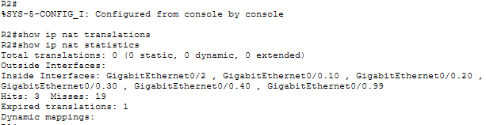
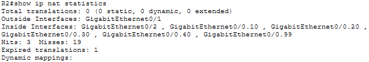
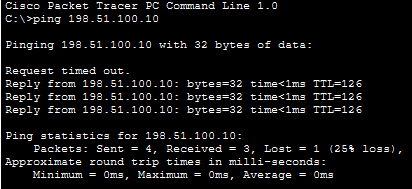
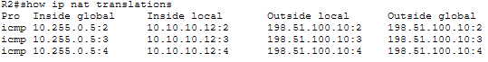

# Incident 4 — Internet Connectivity Failure

**Severity:** High
**Affected Service:** Internet Connectivity / NAT
**Environment:** Enterprise Network Lab

## 1. Incident Summary

Internal network devices were unable to access resources outside the local network. A `ping` test from an internal PC to the Internet server (198.51.100.10) failed, indicating an external connectivity issue.

*Evidence — Ping to simulated Internet host failed*

## 2. Troubleshooting Process

I began by testing connectivity between internal PCs, which appeared to be successful. I then pinged the Internet server (198.51.100.10), but the `ping` failed. I accessed R2 and ran `show ip nat translations` and `show ip nat statistics`. The NAT statistics revealed that no outside interface was configured.

## 3. Root Cause

The router's Internet-facing interface was missing the `ip nat outside` configuration. This prevented NAT from properly translating internal private IP addresses for communication with external networks.

*Evidence — NAT statistics initially showed no outside interface*

## 4. Resolution

I accessed R2 and entered the configuration for interface G0/1. I applied the `ip nat outside` command to designate it as the NAT outside interface, allowing NAT to translate traffic destined for external networks.

*Evidence — Configured R2 G0/1 as NAT outside interface*

## 5. Verification

After configuring the NAT outside interface, I ran `show ip nat statistics` and confirmed that GigabitEthernet0/1 was correctly listed under Outside Interfaces. I then pinged the simulated Internet server (198.51.100.10) from an internal PC. Three of four `ping` attempts succeeded, confirming that external connectivity had been restored. Finally, `show ip nat translations` displayed ICMP translations mapping the internal host 10.10.10.12 to the outside address 10.255.0.5 for traffic to 198.51.100.10, confirming that NAT/PAT was translating traffic.

*Evidence — NAT outside interface present after fix*

*Evidence — Ping to Internet host succeeded (3/4 replies)*

*Evidence — ICMP NAT translations visible after successful traffic*

**Final Status: Resolved**
