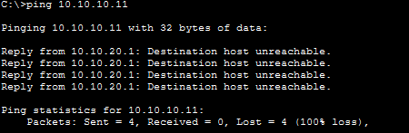
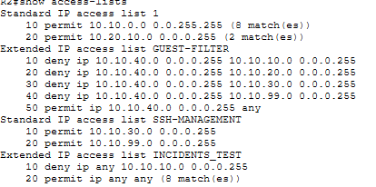
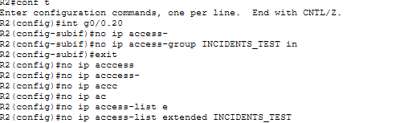
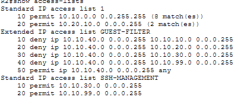
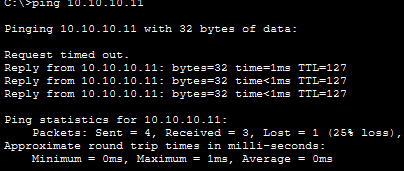

# Incident 5 — ACL Misconfiguration

**Severity:** Medium
**Affected Service:** Network Access Control / Connectivity
**Environment:** Enterprise Network Lab

## 1. Incident Summary

The Sales department was unable to communicate with devices in the HR VLAN (10.10.10.0/24). A `ping` test to an HR device failed, indicating a connectivity issue between the two departments.

*Evidence — Ping from Sales to HR failed*

## 2. Troubleshooting Process

I began troubleshooting by attempting to `ping` an HR device (10.10.10.11) from a Sales PC. The `ping` failed, indicating a connectivity issue between the two VLANs. I then accessed R2 and ran `show access-lists` to examine the configured ACLs. I discovered that the INCIDENTS_TEST ACL contained a rule denying traffic destined for the HR subnet (10.10.10.0/24).

## 3. Root Cause

The INCIDENTS_TEST ACL was misconfigured to deny traffic destined for the HR subnet (10.10.10.0/24). Because the ACL was applied inbound on the Sales VLAN interface, traffic from Sales devices attempting to reach HR was discarded.

*Evidence — Misconfigured ACL denied HR-destined traffic*

## 4. Resolution

I accessed R2 and removed the misconfigured INCIDENTS_TEST ACL from interface G0/0.20 using `no ip access-group INCIDENTS_TEST in`. I then deleted the incorrect ACL using `no ip access-list extended INCIDENTS_TEST`.

*Evidence — Removed and deleted INCIDENTS_TEST ACL*

## 5. Verification

After removing the misconfigured ACL, I pinged an HR device from a Sales PC. The `ping` was successful, confirming that communication between the Sales and HR VLANs had been restored. The post-fix screenshot shows three successful replies out of four attempts.

*Evidence — ACL no longer appears in access list output*

*Evidence — Post-fix Sales-to-HR ping succeeded (3/4 replies)*

**Final Status: Resolved**
